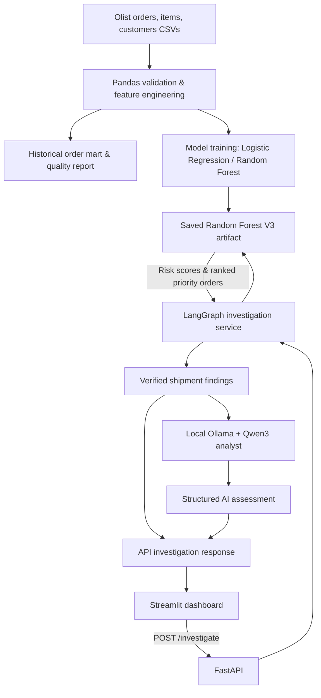

# Olist Logistics AI Control Tower

**An end-to-end machine-learning and local-LLM prototype for prioritizing e-commerce delivery risks and supporting evidence-grounded shipment investigations.**

[](https://github.com/Madhavi115/olist-ogistics-control-tower/actions/workflows/ci.yml)


> **Project status:** Working local prototype, not a deployed or real-time logistics product. Historical prediction scores are **not calibrated probabilities**; priority flags represent rank within a submitted batch.

## Dashboard screenshots

### Control Tower overview


*Actual Streamlit dashboard running locally. The five-order demonstration shows one priority investigation, with `ORDER-004` ranked first at a relative model score of `0.6039`.*

### Shipment risk leaderboard


*Interactive ranking of five demo shipments, with the highest-ranked order flagged for investigation. Scores are relative model outputs, not calibrated delivery-delay probabilities.*

The dashboard also provides an **AI analyst** tab for structured Qwen3 investigation summaries, a **Verified evidence** tab for deterministic findings, and an **ML performance** tab for historical holdout metrics. These other tabs are features of the running application, not pictured in the screenshots above.

## Business problem and approach

Logistics teams cannot manually investigate every order. This prototype explores how to **rank orders by possible delivery-delay risk**, investigate the top-ranked subset, and clearly separate **observed order facts** from **generated recommendations**.

- Build a repeatable Olist data pipeline and quality report.
- Train and compare models using historical, chronological splits.
- Expose single-order prediction, batch risk ranking, and investigation APIs.
- Orchestrate evidence collection and report generation with LangGraph.
- Use a free, locally running **Ollama/Qwen3** model to draft structured investigation summaries.
- Display findings in an interactive **Streamlit + Plotly** dashboard.

## Architecture



**Grounding:** The investigation response includes deterministic findings alongside the LLM-generated assessment. The LLM has no live carrier tracking access and must not imply that an actual delay or its cause has been confirmed.

## Model results

The following results come from a **chronological 60% train / 20% validation / 20% test** experiment on historical delivered orders. Model selection used validation **average precision**; reported performance below is on the later, held-out **19,294-order test period**.

| Holdout metric | Logistic Regression | Random Forest V3 |
|---|---:|---:|
| ROC-AUC | 0.6950 | **0.7380** |
| Average precision | 0.0700 | **0.0778** |
| Precision@top 10% | 6.74% | **9.27%** |
| Recall@top 10% | 19.29% | **26.56%** |
| Actual late orders found among 1,930 flagged | 130 | **179** |
| Lift@top 10% vs batch prevalence | 1.93× | **2.65×** |

**Interpretation:** At an identical **1,930-order investigation budget**, Random Forest identified **49 more late deliveries** than Logistic Regression. The test period contained **674 late deliveries** (3.49% prevalence). These are retrospective, historical ranking results—not evidence that investigations prevented delays or produced cost savings.

**Distribution shift:** The validation late-delivery rate was ~9.93%, versus ~3.49% in the test period. Model scores require additional calibration, prospective validation, and monitoring before operational use.

## Dataset and data quality

Source: [Brazilian E-Commerce Public Dataset by Olist (Kaggle)](https://www.kaggle.com/datasets/olistbr/brazilian-ecommerce).

The pipeline processes **99,441 orders**. Its observed quality report includes **775 orders without item rows**, **1 missing-item order with a carrier handover timestamp**, and **0 delivered orders without items**. These are historical sample-wide counts, not live production metrics.

Download these three source files into `data/raw/` (they are **not** committed to the repository):

```text
data/raw/olist_orders_dataset.csv
data/raw/olist_order_items_dataset.csv
data/raw/olist_customers_dataset.csv
```

Follow the upstream dataset terms; do not redistribute the original raw data from this repository.

## Reproduce locally (macOS / Linux)

**Prerequisites:** Python 3.11+, Git, and optionally [Ollama](https://ollama.com/) for local LLM analysis. The trained model artifact and raw CSVs are not stored in Git.

```bash
# From the cloned repository root
python3.11 -m venv .venv
source .venv/bin/activate
python -m pip install -e ".[dev]"

# Put the three Olist CSVs in data/raw/ first
python -m olist_logistics

# Train V3 (produces artifacts/delay_model_v3.joblib
# and reports/ml_v3_metrics.json)
python -m olist_logistics.ml_v3
```

**Set up local Qwen3 (free, no per-request API charges):**

```bash
ollama pull qwen3:4b
ollama list
```

Keep the Ollama application running. If hardware memory is limited, a smaller Qwen model can be used, but update the `ChatOllama(model=...)` setting in the project accordingly.

Start the backend and dashboard in **separate terminal sessions**, both from the repository root:

```bash
# Terminal 1
source .venv/bin/activate
python -m uvicorn olist_logistics.api:app --reload
```

```bash
# Terminal 2
source .venv/bin/activate
python -m streamlit run dashboard/app.py
```

- Dashboard: **http://localhost:8501**
- Interactive API docs: **http://127.0.0.1:8000/docs**
- Health check: **http://127.0.0.1:8000/health**

In the dashboard, choose **Five demo shipments**, an investigation budget of **10%**, and **Run AI investigation**. For the unchanged V3 artifact and sample orders, the expected highest-ranked shipment is `ORDER-004` (score approximately `0.6039`).

> **Demo only:** The sample orders use historical dates. The dashboard is not tracking ongoing shipments.

## API endpoints

| Method | Path | Purpose |
|---|---|---|
| `GET` | `/health` | Confirm the trained model is available |
| `POST` | `/predict` | Score one order |
| `POST` | `/predict/batch` | Rank multiple orders and flag a configured top fraction |
| `POST` | `/investigate` | Rank orders, run a LangGraph workflow, and return verified findings plus a structured local-LLM assessment |

The dashboard's CSV uploader uses these columns:

```text
order_id,purchase_timestamp,estimated_delivery_date,item_count,total_price,total_freight,customer_state
```

A working example is in [`data/sample_orders.csv`](data/sample_orders.csv). Batch inputs are limited to 1,000 orders in the prototype.

## Testing

```bash
python -m ruff check .
python -m pytest -q
```

The project has **16 passing automated tests** at the latest recorded local/CI milestone. Tests use synthetic or mocked inputs so GitHub CI does **not** require a real Ollama server, live FastAPI process, downloaded Olist CSVs, or a trained model artifact.

A manually executable demonstration client is at `scripts/demo_five_orders.py`; unlike the automated tests, it **requires** the local API and Qwen3 service to be running.

## Repository guide

```text
src/olist_logistics/
  pipeline.py                 # Ingestion, transformations, quality report
  ml.py / ml_v2.py / ml_v3.py # Training and model comparison
  api.py                      # FastAPI prediction and investigation endpoints
  investigation_agent.py     # Deterministic LangGraph report workflow
  investigation_agent_llm.py # Local Qwen3 structured analysis
  investigation_service.py   # Integrated investigation service

dashboard/
  app.py                      # Streamlit UI
  dashboard_core.py           # Validation and API request helpers

data/sample_orders.csv       # Five synthetic/demo requests
reports/                     # Generated metrics, investigation outputs (ignored)
artifacts/                   # Generated model files (ignored)
tests/                       # Automated tests
scripts/demo_five_orders.py  # Live manual demo client
```

## Limitations and next steps

- **Not a live tracking system:** no carrier scans, dispatch telemetry, delivery-status API, or real intervention outcomes.
- **Not probability calibrated:** reported scores are relative ranking outputs and should not be read as literal delay probabilities.
- **Historical validation only:** class prevalence changed substantially across time; no prospective performance guarantee.
- **LLM output requires review:** Qwen3 can still produce unsupported statements. Verified evidence and AI-generated text must remain clearly distinguished.
- **Local prototype:** no public deployment, authentication, audit logs, or user-data governance suitable for production use.

Potential next steps: probability calibration, rolling-origin evaluation, feature-availability audit, carrier integrations, model monitoring, human approval, and secured deployment.

## License and attribution

Olist dataset © its respective owners and contributors. See the [dataset source and its terms](https://www.kaggle.com/datasets/olistbr/brazilian-ecommerce). This repository does not include the original dataset. Review and add a separate license for the project's own source code before specifying reuse rights.
